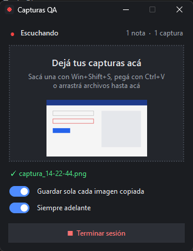

# Dictado de notas QA

Herramienta para Windows que te deja **dictar notas mientras testeás** y **sumar capturas de pantalla** sin cortar el ritmo. Al final del día tenés un log en Markdown, en orden cronológico, y un prompt listo para pedirle a una IA que lo organice en bugs, hallazgos y dudas.



- Cada vez que hacés una pausa al hablar, lo que dijiste se transcribe y queda como una nota con su hora.
- Las capturas que sacás con **Win+Shift+S** se guardan solas y aparecen en el log entre las notas, en el momento en que las sacaste.
- **Todo es local**: la transcripción usa [faster-whisper](https://github.com/SYSTRAN/faster-whisper) en tu PC. Ni el audio ni las capturas salen de la máquina, y después de instalar funciona sin internet.

<br clear="right">

## Requisitos

- Windows 10 u 11.
- [Python](https://www.python.org/downloads/) 3.10 o superior, agregado al PATH (en el instalador: *Add python.exe to PATH*).
- Un micrófono. Con auriculares con micrófono se transcribe mejor.
- ~1 GB libre para el modelo y las dependencias.

## Instalación (una sola vez)

1. Cloná el repo o descargalo como ZIP y descomprimilo.
2. Doble click en **`instalar.bat`**. Crea un entorno virtual en `.venv`, instala las dependencias y descarga el modelo de voz `small` (~480 MB) en `modelos/`. Es el único paso que necesita internet.

<details>
<summary>Instalación a mano</summary>

```bat
python -m venv .venv
.venv\Scripts\python -m pip install -r requirements.txt
.venv\Scripts\python dictado_qa.py --solo-descargar
```
</details>

## Uso

1. Doble click en **`dictar.bat`**. Se abre la consola, donde ves las notas transcriptas, y la ventana de capturas, abajo a la derecha.
2. Quedate callado 1 segundo mientras calibra el ruido ambiente, y empezá a hablar.
3. Cada pausa de ~1,2 s cierra una nota.
4. Para terminar, usá **Terminar sesión** en la ventana, o **Esc** o **Ctrl+C** en la consola. Antes de cerrar transcribe lo que quedaba pendiente y muestra un resumen.

### Capturas de pantalla

La ventana tiene tres formas de cargar imágenes:

1. **Automática**: sacás una captura con **Win+Shift+S** y se guarda sola. Se activa o desactiva con el switch *Guardar sola cada imagen copiada*. Ojo: guarda **cualquier** imagen que copies, así que apagalo si vas a copiar imágenes que no son de la prueba.
2. **Pegar**: click en la ventana y **Ctrl+V**. Sirve para una imagen o para archivos de imagen copiados en el Explorador.
3. **Arrastrar**: soltás archivos `.png`, `.jpg` o `.jpeg` sobre la ventana. Se copian y el original queda donde estaba.

Las imágenes se guardan en `capturas/YYYY-MM-DD/`. También podés dejarlas directamente en `capturas/`: se mueven solas a la carpeta del día. Si un nombre ya existe, la nueva se renombra (`captura_2.png`) y no se pisa ninguna.

## Qué genera

Un log por día en `notas/notas_testing_YYYY-MM-DD.md`, con notas y capturas en orden cronológico:

```
[10:15:02] El botón de guardar no hace nada cuando el formulario tiene un campo vacío

[10:15:09] 📷 Imagen: captura_10-15-09.png


[10:15:20] En la consola aparece un error 500 del endpoint de guardado
```

En la vista previa de VSCode o en Obsidian, las capturas se ven embebidas.

| Archivo | Contenido |
|---|---|
| `notas/notas_testing_YYYY-MM-DD.md` | El log del día. Se guarda en disco con cada entrada nueva, así que no se pierde nada si se corta. Cada sesión del día va bajo su propio título `## Sesión HH:MM:SS`. |
| `notas/notas_testing_YYYY-MM-DD_prompt.md` | Todas las notas y capturas del día numeradas, con un prompt para pegar en una IA y que las organice en bugs, hallazgos y dudas. Se regenera al cerrar cada sesión. |
| `notas/fallidos/*.wav` | Audio de las notas que no se pudieron transcribir, para no perderlas. |

Cada nota lleva la hora en que empezaste a hablar. Una captura pegada o guardada sola lleva la hora en que se guardó. Un archivo arrastrado conserva su fecha de modificación, que es el momento en que se sacó. Si una captura no tiene ninguna nota de voz a menos de 2 minutos, queda en su hora pero marcada con _(sin nota de voz cercana)_.

> Mientras dictás, el bloque de la sesión en curso se reescribe con cada entrada nueva. Si querés editarlo a mano, hacelo después de terminar la sesión. Lo que edites en sesiones anteriores se conserva.

## Opciones

Se pasan como argumentos a `dictar.bat` (por ejemplo `dictar.bat --modelo base`):

| Opción | Para qué |
|---|---|
| `--listar-dispositivos` | Ver los micrófonos disponibles |
| `--dispositivo N` | Usar un micrófono específico (número o nombre) |
| `--modelo base` | Modelo más rápido y menos preciso (`tiny`, `base`, `small`, `medium`). Se descarga la primera vez que se usa. |
| `--silencio 2` | Segundos de silencio que cierran una nota (default 1.2) |
| `--umbral 0.02` | Umbral de voz fijo, si la calibración automática corta de más o de menos |
| `--max-segundos 30` | Duración máxima de una nota (default 30 s) |
| `--sin-ventana` | No abrir la ventana de capturas |
| `--carpeta-capturas RUTA` | Usar otra carpeta de capturas (default `./capturas`) |
| `--distancia-imagen 120` | Segundos sin notas alrededor de una captura para marcarla como "sin nota de voz cercana" |

## Problemas comunes

- **"No se detectó ningún micrófono"**: Windows no tiene un micrófono de entrada por defecto. Conectalo, revisá *Configuración > Sistema > Sonido > Entrada* o elegí uno con `--dispositivo`.
- **Al calibrar dice "ruido ambiente: 0.0000" y no toma notas**: el micrófono está muteado (revisá el botón de mute de los auriculares).
- **Corta las frases a la mitad**: subí `--silencio` (por ejemplo, 2).
- **Toma ruido de fondo como notas**: subí `--umbral`. Mirá el valor que muestra al calibrar y probá con el doble.
- **Transcribe lento**: usá `--modelo base`.

## Licencia

[MIT](LICENSE): podés usarlo, modificarlo y compartirlo libremente.
